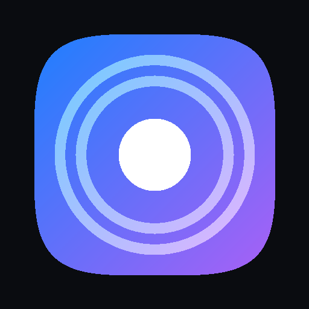

# 🌌 AirAudio by SkyHive
### Преврати любые гаджеты в домашний 3D-кинотеатр и объёмную аудиосистему!

 

### ⬇️ Скачать готовую программу (в 1 клик, без регистрации):

&nbsp;&nbsp;

*(Внутри уже встроено всё необходимое — установка библиотек не требуется)*

---

## 💡 Зачем нужен AirAudio by SkyHive?

У вас дома наверняка есть ноутбук, свой смартфон, телефон друга, старый планшет или портативная колонка. 

**AirAudio by SkyHive объединяет все эти устройства по Wi-Fi в единую мощную 3D аудиосистему!**

* 🎬 **Кинотеатр с 3D-звуком дома**: разложите смартфоны и ноутбуки вокруг дивана при просмотре фильмов — звук станет по-настоящему панорамным и кинематографичным, как в кинозале!
* 🎵 **Объёмная пространственная музыка**: любимые треки больше не звучат «из одной точки» — комната наполняется плотным, кристально чистым 32-bit звуком со всех сторон.
* 🎛 **Один пульт для всех**: нажимайте Play, паузу, меняйте громкость или переключайте треки с любого смартфона или ноутбука — всё переключается синхронно на всех устройствах сразу!
* 📲 **Никаких установок на телефоны**: друзьям не нужно скачивать приложения из App Store или Google Play — они просто наводят камеру на экран и подключаются за 2 секунды через браузер!

---

## ⚡️ Быстрый старт за 60 секунд

### 1️⃣ На основном компьютере:
* **На Mac**: Скачайте `AirAudio-macOS-Share.zip`, запустите `Запустить_AirAudio.command` (или `AirAudio.app`).
* **На Windows**: Скачайте `AirAudio-Windows.zip`, запустите `Запустить_AirAudio.bat`.
* На экране откроется стильный пульт управления и появится **QR-код**.

### 2️⃣ Подключите любые устройства рядом:
* Откройте камеру на **iPhone**, **Android** или планшете (в той же Wi-Fi сети).
* Наведите камеру на **QR-код** на экране ноутбука.
* **Всё!** Наслаждайтесь синхронным объёмным 3D-звучанием вокруг себя!

---

## 🚀 Фирменные фишки

| Фишка | Как это работает |
| :--- | :--- |
| 🎚 **Аппаратная калибровка задержек** | Ползунок синхронизации прямо в реальном времени сдвигает звук на телефоне раньше или позже, начисто убирая эхо даже на лагающих Bluetooth-колонках! |
| 🪟 **Плавающий мини-виджет на ПК** | Кнопка «Мини-виджет» открывает аккуратное окошко поверх всех программ, окон и игр для управления звуком. |
| 📱 **Виджет на экране iPhone** | Настоящий плеер автоматически появляется на экране блокировки iOS и в Dynamic Island при воспроизведении. |
| 📻 **Ламповый звук & 3D Haas Matrix** | Встроенный студийный DSP-процессор с мягким ламповым сатуратором и расширителем стереобазы. |

---

## ⭐️ Поддержите проект

Если вам понравилась идея и приложение:
- ⭐️ **Поставьте звёздочку (Star)** в правом верхнем углу репозитория — это лучшая мотивация для автора!
- 💬 **Есть предложение или отзыв?** Загляните в раздел [**Issues**](https://github.com/NewFuture2/AirAudio/issues), будем рады обратной связи!

---

Разработано с ❤️: [**@NewFuture2**](https://github.com/NewFuture2) • **SkyHive**  
Лицензия: [MIT](LICENSE)

